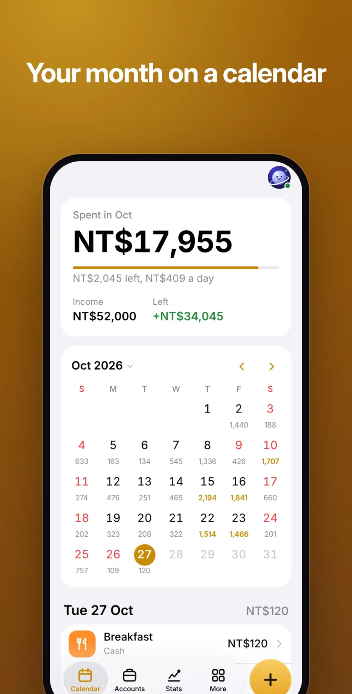
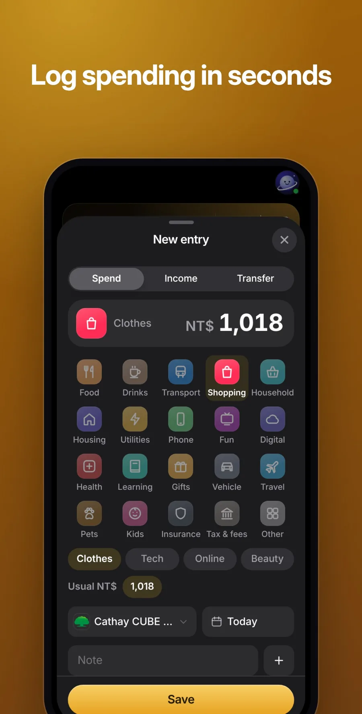
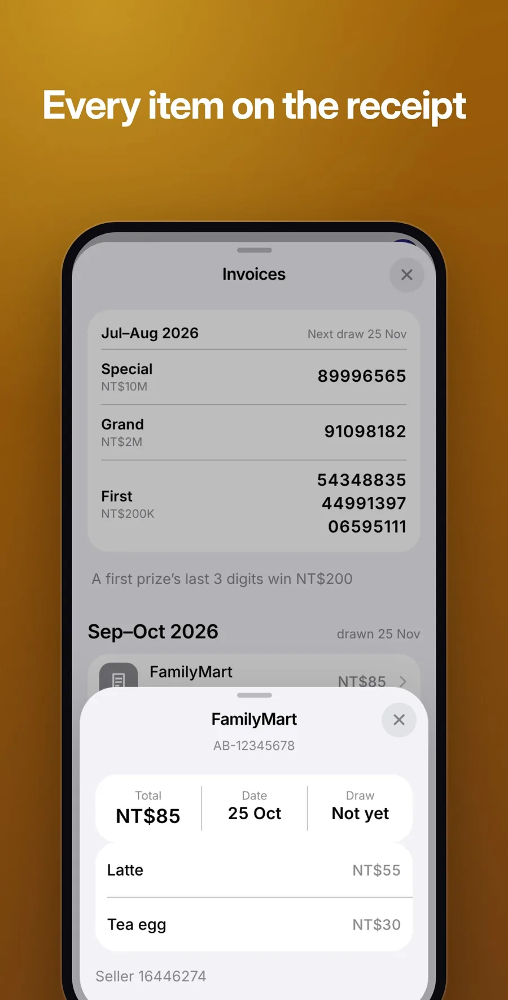
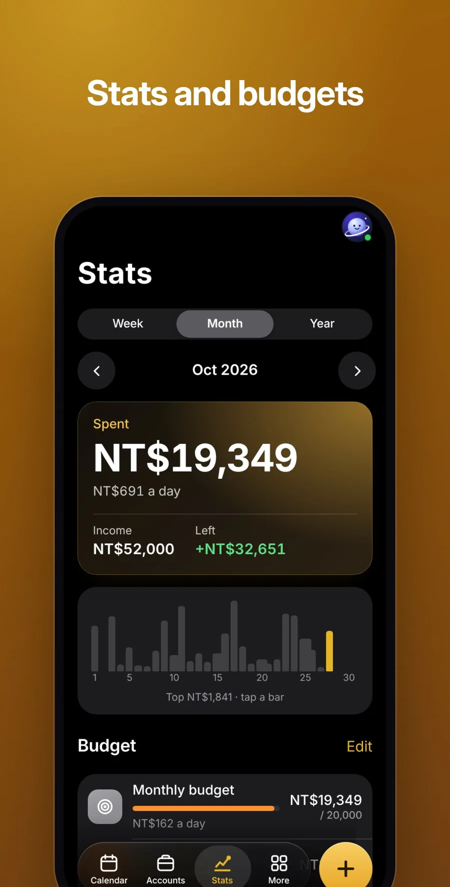
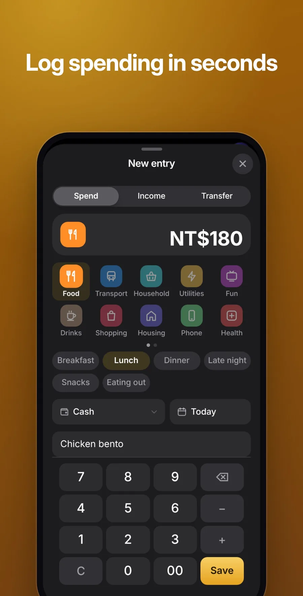

<p align="center">
  
</p>

<h1 align="center">Orbit Money</h1>

<p align="center">
  <b>Every dollar, in its place.</b><br>
  <a href="https://orbit.jaypengx.com/money/"><b>orbit.jaypengx.com/money</b></a>
</p>

<p align="center">
      
</p>

Your own books for real money: what you spend each day, what each account holds, and whether an invoice won. Part of **Orbit**, a family of phone apps for life in Taiwan that share one sign-in, the Orbit Pass. See them all at [orbit.jaypengx.com](https://orbit.jaypengx.com/pass/).

<p align="center">
  
  
  
</p>

<p align="center">
  
  
  
</p>

<p align="center"><sub>Screenshots use made-up sample books.</sub></p>

## Features

- **月曆 Calendar:** the month's spent, income and what's left against the budget; each day's spending in its square, days off marked; a day's entries below.
- **帳戶 Accounts:** cash, banks, 電子票證, 電子支付 and credit cards, each with its own logo; debit cards on a bank; total assets; fixed income and expenses.
- **統計 Stats:** week, month or year against the last, by category, with budgets.
- **發票 Invoices:** the 手機條碼 as a barcode for the till, scanning both QR codes of a paper invoice, importing the e-invoice carrier list (載具) that the 電子發票平台 exports, and checking every invoice against the draw.
- **Entries:** spending, income, moves between your own accounts, balance fixes, categories with sub-categories, and repeats added on their day.
- **Syncs** between devices through the Orbit Pass, record by record.

## Tech stack

| Layer | What |
| --- | --- |
| App | Plain JavaScript (ES modules), HTML and CSS; no framework, no build step, no runtime dependencies |
| Platform | Installable web app with a service worker; the camera reads QR codes with BarcodeDetector, else jsQR |
| Shared | Look, Orbit Pass and the carrier CSV reader from the kit in [Orbit-Core](https://github.com/JayPengX/Orbit-Core) |
| Data | Invoice draws (財政部) and store names (經濟部 GCIS) through the Orbit proxy on Cloudflare Workers |
| Storage | The books on the Orbit Pass (`m1:` + gzip, up to 1 MB) |
| Tests | `node --test` on the books and invoices |

## How it works

- **The books are pure and tested** (`lib/books.mjs`): accounts, entries, budgets and repeats, each record stamped with its last change. A removal is a tombstone kept 120 days, and two devices merge record by record, the newest change winning.
- **Nothing comes in twice:** each imported invoice is keyed by its number, and its category is guessed from the store and the items.
- **Real money, apart from Orbit's play money:** the app never invents entries, balances or categories.

Details: **[MAP.md](MAP.md)**.

## Project structure

```
public/
├── index.html, app.mjs, shell.mjs, money.css
├── views/               calendar, accounts, stats, invoices, entry, scan,
│                        carrier import, categories, more
├── lib/
│   ├── books.mjs        the books: records, totals, merging
│   ├── invoice.mjs      QR codes, the draw, the barcode
│   ├── cats.mjs         categories and guessing them
│   └── logos.mjs, brands.mjs   banks' and wallets' logos
├── img/brand/, vendor/  logos; jsQR
└── sw.js
tools/sample-books.mjs   made-up books for screenshots
tests/                   node --test
MAP.md                   how it works
```

## Getting started

The app loads the shared kit from a sibling folder, so clone this repo next to [Orbit-Core](https://github.com/JayPengX/Orbit-Core):

```bash
git clone https://github.com/JayPengX/Orbit-Core.git
git clone https://github.com/JayPengX/Orbit-Money.git
cd Orbit-Money
```

Requirements: Node.js 22 or newer. There is nothing to install: no framework, no `node_modules`.

```bash
npm test   # links ../Orbit-Core/kit as .kit, then runs node --test
```

See it on a phone-sized screen, signed in with a made-up wallet (needs Playwright):

```bash
# a screenshot, saved in /tmp/orbit-preview
node ../Orbit-Core/tools/preview.mjs money --width 375
# serve it, then open http://localhost:8123/Orbit-Money/
node ../Orbit-Core/tools/preview.mjs money --serve --port 8123
```

`--dark`, `--lang en`, `--webkit` (Safari's engine) and the other flags are listed in [Orbit-Core/tools/README.md](https://github.com/JayPengX/Orbit-Core/blob/main/tools/README.md).

See it with made-up books instead of an empty one:

```bash
node tools/sample-books.mjs > /tmp/books.txt
node ../Orbit-Core/tools/preview.mjs money cal accts stats inv --webkit --width 320 --payload /tmp/books.txt
```

## Deploying

Push to `main`. GitHub Actions runs the tests, stamps every file with its content hash (so a phone downloads only what changed) and publishes `public/` to GitHub Pages; the site Worker serves it at its orbit.jaypengx.com address. There are no pull requests or release branches.

## Credits

QR reading falls back to [jsQR](https://github.com/cozmo/jsQR) (Apache-2.0), kept in `public/vendor/`.

## Part of Orbit

| App | What it is |
| --- | --- |
| [Orbit Sports](https://github.com/JayPengX/Orbit-Sports) | Every game you can watch in Taiwan, live |
| [Orbit Transit](https://github.com/JayPengX/Orbit-Transit) | Bus, train, metro and YouBike, planned and navigated |
| [Orbit Weather](https://github.com/JayPengX/Orbit-Weather) | One clear forecast, to the township |
| [Orbit Words](https://github.com/JayPengX/Orbit-Words) | English vocabulary that stays |
| [Orbit Securities](https://github.com/JayPengX/Orbit-Securities) | A Taiwan broker on play money |
| [Orbit Class](https://github.com/JayPengX/Orbit-Class) | Today's classes at a glance |
| [Orbit Beats](https://github.com/JayPengX/Orbit-Beats) | Endless music and your own beats |
| [Orbit Law](https://github.com/JayPengX/Orbit-Law) | Laws, rulings and bills, linked |
| [Orbit Money](https://github.com/JayPengX/Orbit-Money) | Your own books |
| [Orbit-Core](https://github.com/JayPengX/Orbit-Core) | The kit, the Orbit Pass and the Workers behind them all |

How it was all built, in pictures and numbers: [jaypengx.com/showcase](https://jaypengx.com/showcase/).
